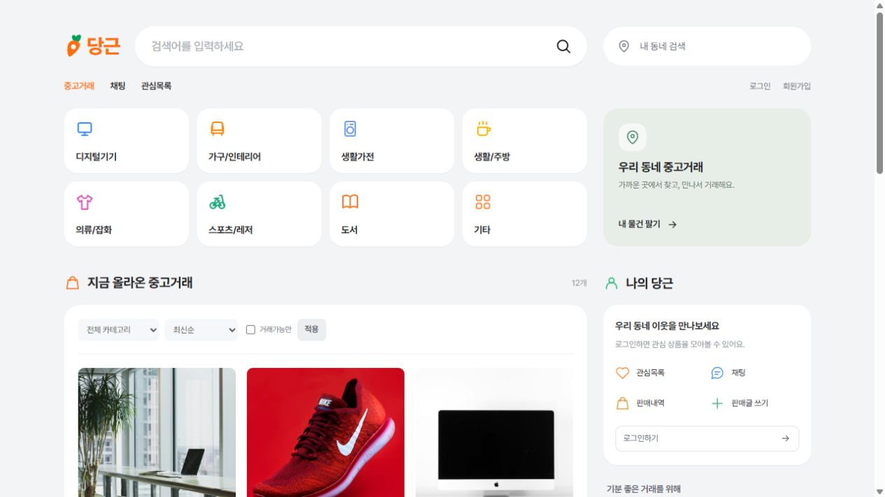
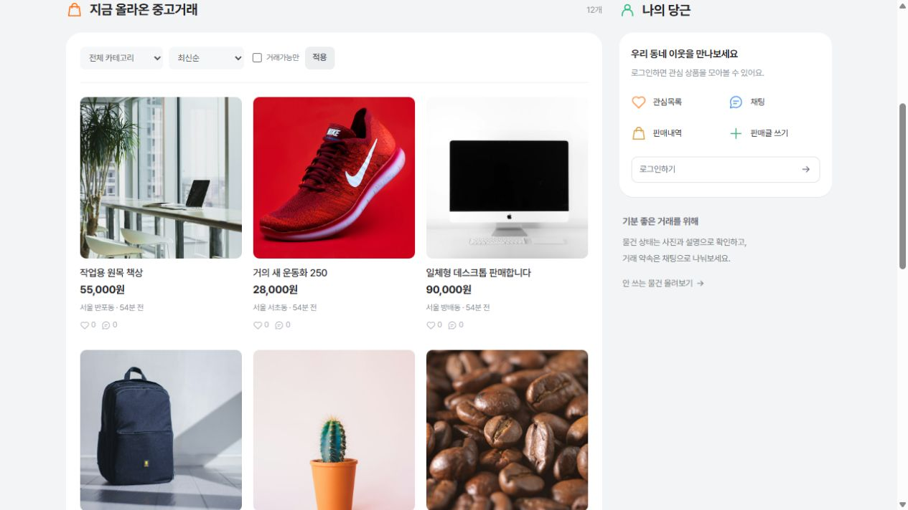

# jango-danggeun-market — 당근마켓 Django 과제

내 저장소: https://github.com/chanmini584-ux/jango-danggeun-market

원본 저장소: https://github.com/realbro-0618/Django_danggeun_market

당근마켓의 주황색, 동네 중심 검색, 상품 카드, 모바일 하단 메뉴를 참고한 학습용 중고거래 웹앱입니다.
실제 당근 서비스와 무관한 과제 프로젝트입니다.
원본 GitHub main의 게시판·찜·Channels 채팅 구현(262f20a)을 기반으로 개선했습니다.

## Windows 빠른 실행

Python 3.13 권장. 이 README가 있는 폴더에서 실행합니다.

```powershell
powershell -ExecutionPolicy Bypass -File .\start.ps1
```

브라우저: http://127.0.0.1:8000/ · 중지: Ctrl+C
첫 실행 시 가상환경·의존성·SQLite 데이터베이스를 준비합니다.
예시 상품은 아래 명령으로 추가할 수 있습니다. 재실행해도 중복되지 않습니다.

```powershell
.\.venv\Scripts\python.exe manage.py seed_market
```

샘플 상품 12개는 로컬에 저장된 Unsplash 사진을 사용합니다. 출처는 `market/static/market/products/PHOTO_SOURCES.md`에 정리했습니다. 샘플 판매자 계정은 로그인이 불가능합니다.
회원가입에서 자신의 테스트 계정을 생성하세요. 기본 비밀번호는 없습니다.

## 구현 기능

- 회원가입, 로그인, POST 로그아웃, 이름·생년월일·휴대폰 프로필
- 상품 목록·상세·조회수, 제목/본문 검색, 지역·카테고리 필터
- 최신순/낮은 가격순 정렬, 거래완료 제외, 페이지네이션
- 사진 업로드(5MB 이하), 상품 등록·수정·삭제: 작성자 권한 확인
- 판매중·예약중·거래완료 상태 변경, 0원 나눔 표시
- 관심 등록·취소, 내 관심목록, 내 판매내역
- 상품별 구매자·판매자 1:1 실시간 채팅, 메시지 DB 저장, 참여자 접근 제한
- PC·모바일 반응형 화면, 비어 있는 목록·오류·채팅 연결 끊김 안내

## 직접 설치와 검증

```powershell
python -m venv .venv
.\.venv\Scripts\python.exe -m pip install -r requirements.txt
.\.venv\Scripts\python.exe manage.py migrate
.\.venv\Scripts\python.exe manage.py seed_market
.\.venv\Scripts\python.exe manage.py check
.\.venv\Scripts\python.exe manage.py test
.\.venv\Scripts\python.exe manage.py runserver 127.0.0.1:8000
```

테스트는 인증, 검색, 업로드, 작성자 권한, 찜, 상태 변경, 채팅 접근 제한과 WebSocket 양방향 전달·저장을 포함합니다.
테스트는 별도의 테스트 DB를 사용하므로 실제 상품을 삭제하지 않습니다.

## 발표용 시연 순서

1. 홈 화면과 상품 카드 확인 → ‘의자’ 검색 → 지역·카테고리 필터 적용 후 검색.
2. 회원가입 → 사진을 첨부해 판매글 작성 → 내 판매내역에서 수정·거래 상태 변경.
3. 다른 브라우저나 시크릿 창에서 두 번째 계정 생성 → 첫 계정의 상품 찜.
4. 상품 상세에서 ‘채팅으로 거래하기’ → 첫 계정의 채팅 목록에서 대화방 접속.
5. 두 창에서 메시지 전송 → 새로고침 후에도 대화가 남는지 확인.
6. 다른 계정으로 남의 판매글을 수정하거나 대화방에 접근할 수 없는 권한 구조 설명.

## 구성과 설정

- `market/models.py`: Profile, Product, Wishlist, ChatRoom, ChatMessage
- `market/views.py`, `forms.py`: 폼 검증과 HTTP 요청 처리
- `market/consumers.py`, `routing.py`: Channels WebSocket 채팅
- `templates/market/`: Django 화면 템플릿
- `market/static/market/`: CSS, 예시 상품 일러스트
- `market/management/commands/seed_market.py`: 시연 데이터

`.env.example`을 참고해 `.env`를 선택적으로 생성합니다.
DB_NAME이 없으면 SQLite, 있으면 PostgreSQL을 사용합니다.
사진은 기본적으로 `media/products/`에 저장됩니다.
Supabase Storage를 사용하려면 `pip install supabase` 후 SUPABASE_URL과 SUPABASE_SERVICE_ROLE_KEY를 설정하고
`product-images` 공개 버킷을 준비하세요. 비밀 키를 Git에 올리지 마세요.

채팅의 InMemoryChannelLayer는 로컬 단일 프로세스 시연용입니다.
운영 시에는 Redis 채널 레이어, 운영 ASGI 서버, HTTPS와 정적/미디어 파일 서빙이 필요합니다.
운영 배포에서는 DJANGO_DEBUG=false, 고유한 DJANGO_SECRET_KEY와 실제 허용 호스트를 설정하세요.
실제 GPS 동네 인증·결제·푸시 알림은 구현 범위에 포함되지 않습니다.

## 화면 미리보기





## 디자인 리소스

- Pretendard v1.3.9를 로컬 호스팅합니다. SIL Open Font License 원문은 `market/static/market/fonts/LICENSE.txt`에 포함되어 있습니다.
- 첨부된 당근 화면을 참고해 검색 중심 헤더, 회색 배경, 흰색 카드, 공통 SVG 아이콘과 간결한 문구를 적용했습니다.
- 시연 상품 사진은 예시이며 실제 판매 중인 물건이 아닙니다.

## 변경 이력

### 2026-10-29 · v2.1.0
- Pretendard 가변 폰트와 텍스트 크기·굵기·간격 체계 적용.
- 대형 홍보 배너 제거, 검색·카테고리·상품 목록·나의 당근 중심으로 화면 재구성.
- 메뉴 아이콘 SVG 통일, 회색 배경과 흰색 카드, PC/모바일 여백 정리.
- 샘플 상품만 사진으로 변경. 기존 사용자 등록 상품 보존.
- 기존 테스트 12개 통과, 브라우저 카테고리 연결과 390px 모바일 화면 확인.


### 2026-10-29 · v2.0.1
- 본인 저장소의 기존 커밋 이력을 유지해 UI와 중고거래 기능 통합.
- 기존 사진 업로드 오류를 폼에 표시하는 처리를 로컬/외부 업로드 모두에 유지.
- SQLite DB와 Python 캐시는 로컬에 보존하고 Git 추적에서 제외.
- 업로드 실패 시 상품 등록/수정이 저장되지 않는 회귀 테스트 추가. 전체 테스트 12개 통과.


### 2026-10-29 · v2.0.0
- GitHub main의 상품 게시판·찜·Channels 채팅 소스 반영.
- 당근마켓 형태의 공통 레이아웃과 반응형 상품·회원·채팅 화면 구현.
- 검색·필터·정렬·페이지네이션, 나의 판매/관심 목록, 거래 상태 추가.
- 외부 서비스 없이 로컬 사진 업로드 지원, 예시 상품 12개와 일러스트 추가.
- 상품/채팅 권한, 사진 업로드, WebSocket 전달·저장 포함 테스트 11개 통과.

### 2026-10-15 · v1.0.0
- 원본 인증 화면 복제, SQLite 실행 경로, Windows 실행 스크립트와 기본 인증 테스트 추가.
